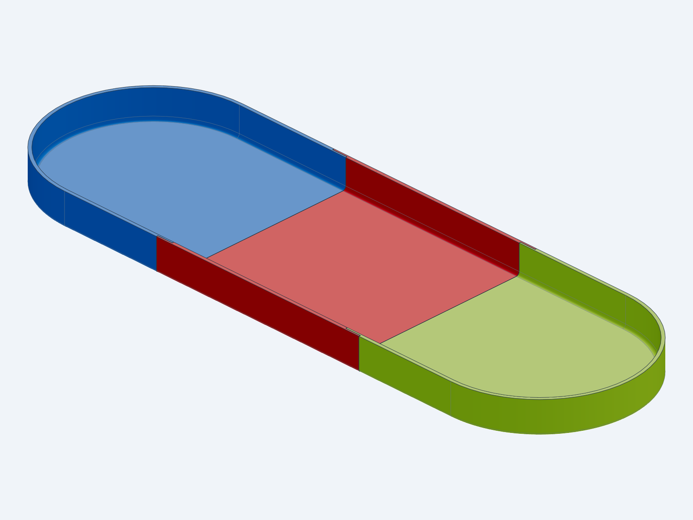
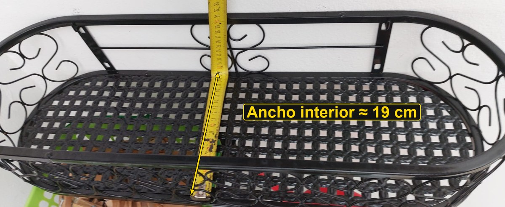
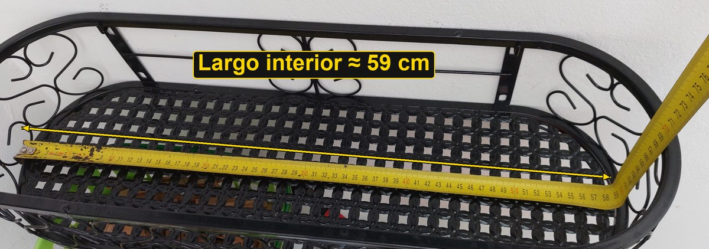
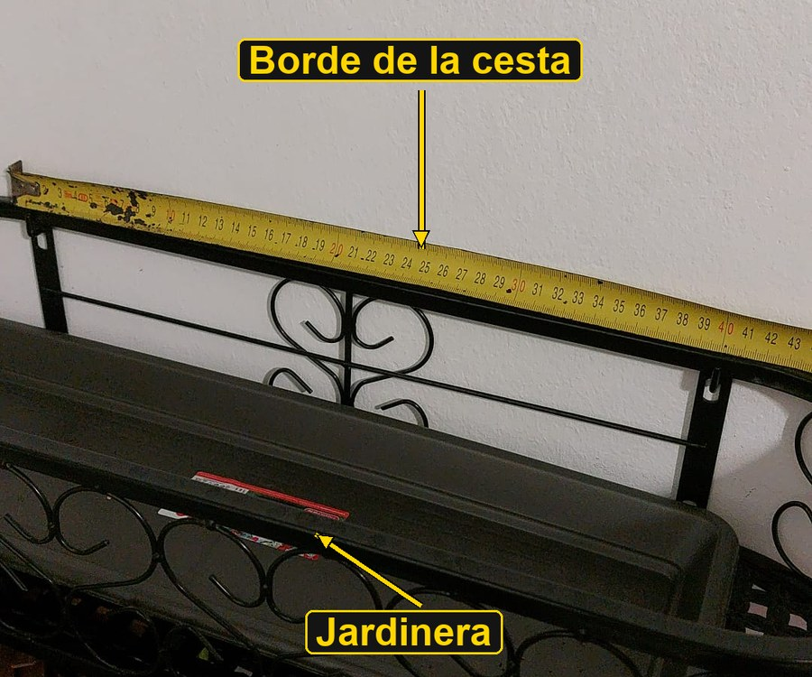
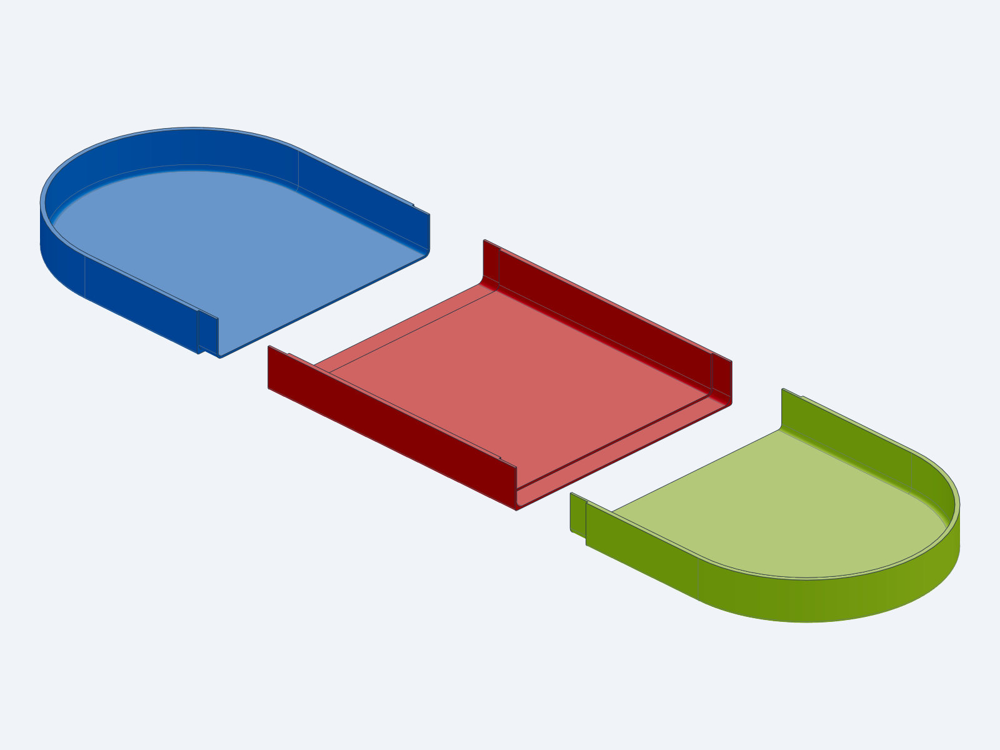
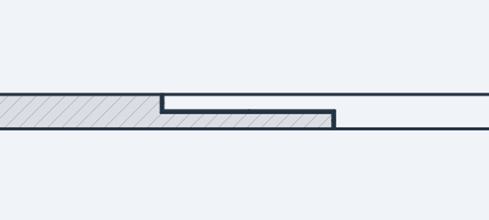

# Una bandeja a medida para una cesta de forja

Tengo una cesta de forja para plantas con forma de **estadio**: dos lados rectos
y los extremos redondeados. Dentro va una jardinera, y quería una bandeja
debajo que recogiera el agua del riego y ocupara todo el fondo, así que la
diseñé a medida y la imprimí en 3D. Este es el proceso.



---

## 1. Medir la cesta

Con un flexómetro tomé las dos medidas interiores del fondo.

### Ancho interior: unos 19 cm



Este ancho es también el diámetro de los extremos redondeados.

### Largo interior: unos 59 cm



Con un ancho de 19 cm, los extremos redondeados suman 19 cm, así que el
**tramo recto mide 40 cm** (59 − 19).

### La jardinera dentro de la cesta



La jardinera es rectangular, pero el fondo de la cesta tiene los extremos
redondeados. Para recoger bien el agua, la bandeja tenía que seguir la forma de
la cesta y no la de la jardinera.

---

## 2. Del tamaño de la cesta al de la bandeja

Dejé **3 mm de holgura por cada lado** para que la bandeja entre sin forzar:

| Medida | Cesta | Bandeja |
|---|---|---|
| Ancho / diámetro de los extremos | 190 mm | 184 mm |
| Tramo recto | 400 mm | 400 mm |
| Largo total | 590 mm | 584 mm |
| Alto | — | 30 mm |
| Grosor de pared y de suelo | — | 3 mm |

## 3. El problema: no cabe en la impresora

Con 584 mm de largo, la bandeja no cabe en la cama de la impresora (256 mm).
La solución fue **dividirla en 3 piezas** de unos 20 cm, que caben con margen, y
pegarlas.



Para que las uniones sean resistentes y no goteen, en lugar de cortar recto las
hice **a media madera**. En cada unión, una pieza conserva la mitad exterior de
la pared y del suelo y la otra la mitad interior, y se solapan 15 mm:



Entre las dos caras dejé 0,15 mm de holgura para el pegamento. Los cortes están
siempre en el tramo recto, nunca en las curvas, para que el solape sea igual a
lo largo de toda la unión.

## 4. El modelo

Lo modelé en Python, en [`drip_tray.py`](drip_tray.py), con
[build123d](https://github.com/gumyr/build123d). Primero se hace la bandeja
entera como un único sólido y luego se corta en piezas. Así las piezas siempre
coinciden con la bandeja completa.

Todas las medidas están al principio del script: holgura, alto, grosores,
número de piezas, solape y holgura de pegamento. Para regenerarlo:

```bash
python drip_tray.py
python checks/check_drip_tray.py   # comprobaciones de geometría
```

El script de comprobación revisa que cada pieza sea un sólido válido, que quepa
en la cama y que las uniones encajen con la holgura prevista.

**Archivos:**

- `STEP/`: bandeja completa, cada pieza y el conjunto montado y despiezado
- `STL/`: mallas de cada pieza para imprimir
- `slice/`: piezas ya laminadas para Bambu Lab (`.gcode.3mf`) y los ajustes usados

## 5. Imprimirla

La laminé para una **Bambu Lab P1S** con **ABS**:

| Ajuste | Valor |
|---|---|
| Altura de capa | 0,2 mm |
| Paredes | 3 |
| Relleno | 100 % (para que sea estanca) |
| Soportes | Sí |
| Brim | Solo por fuera |

| Pieza | Tiempo | Filamento |
|---|---|---|
| A | ~3,0 h | ~136 g |
| B | ~3,0 h | ~138 g |
| C | ~3,0 h | ~136 g |
| **Total** | **~9 h** | **~410 g** |

Para montarla, pega las uniones con un pegamento adecuado para ABS (por ejemplo
cemento de ABS o epoxi). Antes de usarla, llénala de agua para comprobar que no
gotea.

## Herramientas

- **Medición:** flexómetro.
- **Modelado:** Python con build123d.
- **Laminado:** Bambu Studio.
- **IA:** me ayudé de una IA para redactar este texto, editar las fotos (recorte,
  cotas y flechas) y revisar el modelo.
